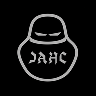
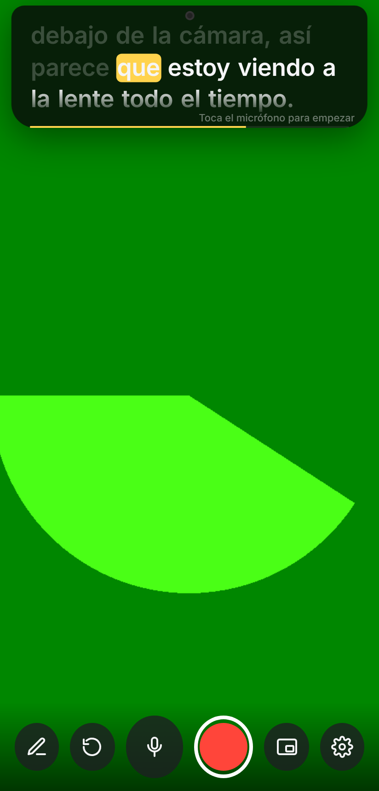
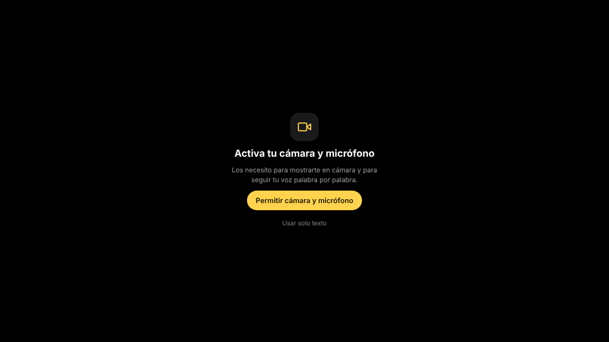

<p align="center">
  
</p>

<h1 align="center">TexJAHC</h1>

<p align="center">
  <b>Teleprompter que sigue tu voz palabra por palabra, justo debajo de la cámara.</b><br>
  Para <b>Android</b> y <b>Windows</b>. Gratis y de código abierto.
</p>

<p align="center">
  <a href="https://j2916artprepa2a-ux.github.io/prompter-voz/"><b>▶ Abrir la app</b></a>
</p>

---

Escribe tu guion, toca el micrófono y habla. El texto se queda pegado arriba, debajo del lente, así **parece que miras a la cámara todo el tiempo**. Cada palabra que dices se ilumina y el texto avanza solo: no tienes que ajustar velocidad ni que alguien te lo mueva.

<p align="center">
  
  &nbsp;&nbsp;
  
</p>

## Funciones

- 🎙️ **Sigue tu voz palabra por palabra**: subraya la palabra que te toca decir y avanza mientras hablas.
- 🧠 **Voz integrada (sin internet)**: reconoce tu voz dentro del teléfono con [Vosk](https://github.com/ccoreilly/vosk-browser), usando el mismo audio que se graba. Así puedes **grabar y que el texto te siga al mismo tiempo en Android**. Solo reconoce palabras de tu guion, por eso es más preciso.
- 🎧 **Micrófono externo**: elige en Ajustes el micrófono USB-C, de solapa o inalámbrico.
- 🔁 **Te alcanza si te saltas algo**: si brincas una frase, se ubica solo. Si repites palabras o hay ruido, no se mueve de más.
- 📷 **Texto debajo de la cámara**: panel tipo *notch* arriba de la pantalla, pegado al lente frontal.
- ⏺️ **Graba video con audio** desde la app y lo guarda solo al terminar.
- 🔄 **Cambia de cámara mientras grabas**: frontal ⇄ trasera cuantas veces quieras, sin dejar de grabar; la voz te sigue y al final sale un solo video.
- ⏸️ **Clips como TikTok**: pausa y sigue; si no te gustó el último clip, bórralo (⌫) y el texto regresa a donde empezaba. Al final los clips se unen en un solo video dentro del cel ([ffmpeg.wasm](https://github.com/ffmpegwasm/ffmpeg.wasm)).
- 🎬 **Ayudante de tomas**: escribe `[PAUSA]` y `[indicaciones]` en tu guion; se pausa solo al terminar cada toma y te dice qué sigue.
- 🪟 **Ventana flotante en Windows**: el texto queda **siempre encima** de cualquier app (Zoom, OBS, Cámara de Windows, Meet…). Arrástrala debajo de tu webcam.
- 👆 Toca cualquier palabra para saltar ahí o arrastra el texto con el dedo.
- 🔤 Tamaño de letra, líneas visibles, idioma de voz y modo espejo para cristal de teleprompter.
- ⌨️ Atajos en la compu: `Espacio` pausa/sigue · `↑ ↓ ← →` mueven · `R` reinicia.
- 📲 Se instala como app (PWA) y recuerda tu último guion.
- 🔒 **Tu guion es privado**: empieza vacío, se guarda solo en tu dispositivo, no se manda a la IA y lo puedes eliminar cuando quieras (✏️ → 🗑️).
- ☰ **Todo en un menú**: desde la pantalla principal tienes a la mano guion, IA (guion, chat, live, entrevista, investigar), grabación, estilo, cuadro, ventana flotante, instalación y ajustes.
- 🔍 **Guía inicial**: revisa permisos, prueba cámara, micrófono y una grabación corta, y te dice cómo arreglar lo que falle.

## 📲 Cuadrito flotante (app Android)

App nativa que pone tu guion **flotando encima de TikTok, Instagram, Facebook o la cámara**. Esas apps graban tu cámara, no tu pantalla, así que el cuadrito **no sale en tu video**.

- Arrástralo a donde quieras (✥), cambia tamaño (A− A+), modo voz 🎙 o automático ⏱.
- Recibe el guion desde la app web: ✏️ → “📲 Mandar al cuadrito flotante”.
- Si Play Protect bloquea la versión **Live** (usa Accesibilidad), instala la normal: tiene todo lo demás. No apagues Play Protect.
- **[Descargar TexJAHC.apk](https://github.com/j2916artprepa2a-ux/prompter-voz/releases/download/android-latest/TexJAHC.apk)** (se compila solo con GitHub Actions; código en `android/`).

## Instalar

### Android
1. Abre **https://j2916artprepa2a-ux.github.io/prompter-voz/** en **Chrome**.
2. Menú `⋮` → **Instalar app** (o "Agregar a pantalla principal").
3. Acepta los permisos de **cámara** y **micrófono**.

### Windows
1. Abre el link en **Chrome** o **Edge**.
2. Haz clic en el ícono de **instalar** en la barra de direcciones.
3. Para usarlo encima de otra app, toca el botón de **ventana flotante** y pon la ventanita justo debajo de tu webcam.

## Cómo funciona

- El reconocimiento de voz usa la **Web Speech API** del navegador (Chrome/Edge), en español de México por defecto.
- Cada vez que dices algo, la app toma tus últimas palabras y las **alinea con el guion** cerca de donde vas. Acepta errores pequeños de pronunciación y saltos hacia adelante, y solo regresa si está muy seguro.
- Todo corre en tu dispositivo. El guion se guarda en tu navegador, no en un servidor.

## Requisitos y limitaciones

- La voz de Google necesita **internet**. La voz integrada descarga ~40 MB la primera vez y luego funciona sin internet.
- Necesita **HTTPS** para cámara y micrófono (GitHub Pages ya lo da).
- En Android, la voz de Google no puede escuchar mientras se graba; por eso la app usa la voz integrada al grabar.
- En Android el texto se muestra dentro de la app; no puede ponerse encima de la app de Cámara del sistema.

## Estructura

```
index.html      # toda la app (interfaz + seguimiento de voz + cámara + grabación)
manifest.json   # datos para instalarla como app
sw.js           # funciona offline
lib/vosk.js     # reconocimiento de voz en el navegador (Vosk, Apache 2.0)
lib/ffmpeg/     # unir clips en un solo video (ffmpeg.wasm)
models/         # modelo de voz en español (lo descarga la acción de GitHub)
icons/          # íconos
```

## Correr en local

```bash
python -m http.server 8000
# abre http://localhost:8000
```

## Créditos

Inspirado en Textream para macOS.

## Licencia

MIT © 2026 Jorge Arturo Hernández Cuéllar
